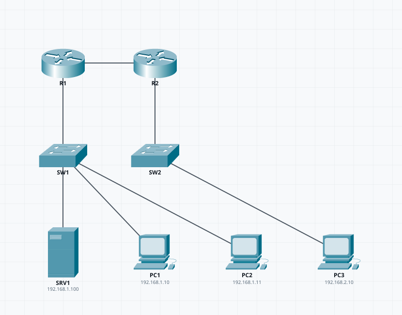

# ptlab

[**English**](README.md) | Espanol

[](https://github.com/samu-jpg/lab-pkt/actions/workflows/ci.yml)
[](LICENSE)
[](https://www.python.org/)

MCP que expone las librerias para armar labs de **Cisco Packet Tracer** y **generar el archivo
`.pkt`** sin abrir Packet Tracer: la IA (o vos) describe el lab con equipos, cables, IPs, VLANs
y routing, y el motor produce un `.pkt` que **ya trae los equipos cableados y configurados**.

## Demo

`ptlab preview` sobre un lab de dos routers (OSPF, Server-PT con DHCP y tres hosts):



El MCP es la caja de herramientas del proyecto: todo se expone como tools y lo opera el agente
que ya tengas (Command Code, Claude, Copilot...), sin costo extra de LLM. No hay UI propia.
**Sin plantillas ni topologias preajustadas**: cada equipo, nombre, cable y direccion los decide
quien usa el MCP.

## Alcance actual
- Topologia **explicita**: `nodes` (equipos) + `links` (cables puerto a puerto), sin plantillas.
- **Primitivas MCP**: crear/editar un `.pkt` equipo por equipo (agregar/quitar/clonar/renombrar,
  mover, prender/apagar, cables copper/crossover/serial, configs IOS crudas, modulos, wireless,
  config-register, OS) e inspeccionar labs existentes.
- **Servicios y seguridad**: servicios del Server-PT (HTTP/HTTPS, DNS, TFTP, NTP, email, syslog,
  AAA/RADIUS, DHCP con pools) y ACL/NAT (estatico, overload) como tools.
- **Actividades `.pka`**: practica guiada (consigna HTML, red inicial y resuelta, password,
  permisos y timer). Sin arbol de correccion: eso el vendor lo deriva de una actividad de
  referencia que hay que tener a mano.
- **Libreria local**: cosecha modelos de tus propios `.pkt` (`pt_harvest`) y desde ahi
  `pt_add_device` los acepta como cualquier otro.
- Catalogo: routers (2911/1941/2901/2811), switches L2 (2960-24TT/2950-24), switch L3 (3560-24PS),
  hosts (PC-PT/Server-PT/Laptop-PT) y Hub-PT; las primitivas aceptan **todos** los modelos del
  template del vendor (100+).
- IPs por interfaz (CIDR), subinterfaces dot1Q (router-on-a-stick), IPs de hosts estaticas o DHCP.
- **VLANs** con access / trunk / SVI y router-on-a-stick; switch L3 con `ip routing`.
- Routing `none`/`static`/`rip`/`ospf`/`eigrp`/`bgp` (global o por equipo, calculado sobre el grafo).
- DHCP: pools en el router, o `Server-PT` con pools + `ip helper-address` (relay).
- Preview **SVG** del plano (iconos reales de Packet Tracer, leidos de la instalacion local).

## Requisitos
- Python 3.10+ (el codec `.pkt` es Python puro: sin dependencias nativas).
- Packet Tracer 9.x (solo para **abrir** el resultado).
- Se probo contra Packet Tracer **9.0.1** generando archivos que abren y rutean.

## Instalacion
```bash
git clone --recurse-submodules git@github.com:samu-jpg/lab-pkt.git
cd lab-pkt
pip install -e ".[mcp]"
```
El extra `mcp` instala el SDK del servidor MCP. El proyecto reutiliza el codec/generador
GPL-3.0 `packet-tracer-pkt-format`, integrado como **submodulo** en `vendor/`
(si clonaste sin submodulos: `git submodule update --init`). Por eso el proyecto es
**GPL-3.0-or-later**.

## Uso — servidor MCP (interfaz principal)
Comando del server (tras la instalacion): `ptlab-mcp` (o `python3 -m ptlab.mcp_server`).
El agente conversa y opera todo por tools.

**Spec -> .pkt / .svg** (describir el lab de una vez):
- `pt_schema` — JSON schema de la spec (que campos acepta).
- `pt_list_models` — catalogo de la spec + todos los modelos y modulos del vendor.
- `pt_plan` — valida/planifica y muestra el resumen con direccionamiento.
- `pt_preview` — genera el SVG.
- `pt_build` — genera el `.pkt`.

**Primitivas sobre un .pkt** (el agente hace lo que quiera, incluso abrir y retocar):
- `pt_new` — crea un `.pkt` vacio; `pt_devices` — lista los equipos.
- `pt_add_device` / `pt_remove_device` — agregar/quitar equipos (cualquier modelo, con config
  IOS y red de host); `pt_add_link` — cables copper/crossover/serial (DCE con clock rate).
- `pt_clone_device` / `pt_rename_device` / `pt_move_device` / `pt_set_power` — duplicar (config
  incluida), renombrar, ubicar y prender/apagar equipos.
- `pt_config` — lineas IOS crudas; `pt_set_host` / `pt_set_dhcp` — red del host.
- `pt_set_wireless` — SSID/seguridad (AP, router o cliente); `pt_install_module` — modulos (HWIC...).
- `pt_set_config_register` / `pt_set_os` — registro de configuracion e imagen de boot.
- `pt_inspect` — lee un `.pkt`: equipos, IPs, configs, pools y enlaces.

**Servicios y seguridad:**
- `pt_set_service` — prender/apagar y configurar servicios (http, https, dns, tftp, ntp, syslog,
  email, aaa, dhcp) con campos crudos.
- `pt_add_dhcp_pool`, `pt_add_dns_record`, `pt_add_aaa_user`, `pt_add_aaa_client` — pool DHCP,
  registros DNS y usuarios/clientes AAA (RADIUS) del Server-PT.
- `pt_add_acl` / `pt_apply_acl` — ACL standard/extended (numerada o con nombre) y `ip access-group`.
- `pt_nat_static`, `pt_nat_overload`, `pt_nat_interface` — NAT estatico, PAT y `ip nat inside/outside`.

**Actividades y libreria local:**
- `pt_activity` — arma un `.pka` con red inicial/resuelta, consigna, password, permisos y timer.
- `pt_harvest` — cosecha modelos de tus `.pkt` a la libreria local (`pt_add_device` los acepta).

Ejemplo de registro en Command Code (`cmd mcp add`):
```bash
cmd mcp add ptlab -- ptlab-mcp
```
O en `.mcp.json`:
```json
{ "mcpServers": { "ptlab": { "command": "ptlab-mcp", "env": { "PTLAB_OUT_DIR": "/mnt/d/PT-Labs" } } } }
```
Mismo patron para Claude Code / Copilot / Cursor (transport stdio).

## Uso — CLI (apoyo para debug)
```bash
ptlab build mi_lab.yaml -o /mnt/d/PT-Labs/mi_lab.pkt   # genera el .pkt
ptlab preview mi_lab.yaml -o /mnt/d/PT-Labs/mi_lab.svg # preview
ptlab schema                                           # campos de la spec
```
El `.pkt` queda en una carpeta accesible desde Windows (por defecto salida en `/mnt/d/PT-Labs`).

## Formato de la spec
```yaml
name: mi_lab
routing: ospf        # none | static | rip | ospf | eigrp | bgp (global; cada nodo puede pisarlo)
ospf_process: 1      # parametros por protocolo
ospf_area: 0
eigrp_as: 100
bgp_as_base: 65000   # AS base para BGP si el nodo no trae as_number
dns: 8.8.8.8         # DNS por defecto de los pools del Server-PT
nodes:
  - name: R1
    model: 2911
    x: 200             # opcional; si falta, layout por capas
    y: 300
    interfaces:
      - {port: GigabitEthernet0/0, ip: 10.0.0.1/30}                    # enlace WAN
      - {port: GigabitEthernet0/1.10, ip: 192.168.10.1/24, dot1q: 10}  # router-on-a-stick
      - {port: GigabitEthernet0/2, ip: 192.168.1.1/24, helper: 192.168.2.100}  # relay DHCP
    routing: ospf      # opcional: pisa el routing global
    as_number: 65010   # para bgp
    dhcp: true         # pools por interfaz /24 del router
    config: []         # lineas IOS extra (escape hatch)
  - name: SW1
    model: 2960-24TT
    vlans: [{id: 10, name: VENTAS}, {id: 20, name: ADMIN}]
    access: [{port: FastEthernet0/1, vlan: 10}]
    trunks: [GigabitEthernet0/1]
    interfaces: [{port: Vlan10, ip: 192.168.10.2/24}]    # SVI (gestion)
  - {name: PC1, model: PC-PT, ip: 192.168.1.10/24, gateway: 192.168.1.1, dhcp: false}
  - name: SRV1
    model: Server-PT
    ip: 192.168.30.11/24
    gateway: 192.168.30.1
    pools: [{network: 192.168.30.0/24, gateway: 192.168.30.1}]
links:
  - {a: R1, a_port: GigabitEthernet0/0, b: R2, b_port: GigabitEthernet0/0}
  - {a: PC1, a_port: FastEthernet0, b: SW1, b_port: FastEthernet0/1, cable: straight}
  - {a: R1, a_port: GigabitEthernet0/1, b: SW1, b_port: GigabitEthernet0/1}
```
Validaciones (mensajes en espanol): nombres unicos, modelo del catalogo, puertos existentes y sin
repetir, IPs CIDR sin duplicados, VLAN 1-4094 declarada antes de usarse, `dot1q` solo en
subinterfaces, hosts con `ip`+`gateway` o `dhcp: true`.

Nota: los routers con pocos puertos (1941/2811/2901/2911: 2-3) limitan cuantos enlaces puede
tener cada equipo; para topologias exigentes usar `3560-24PS` (26 puertos, se configura solo con
`ip routing` y `no switchport`).

## Como funciona (pipeline)
```
spec (YAML/JSON: nodes + links)
  -> planner   : valida, arma equipos/puertos, configs IOS y layout
  -> builder   : plantillas de equipos reales (vendor) -> XML -> cifrado -> .pkt
  -> preview   : SVG del plano

primitivas:
  pt_new/open -> lab_api (agregar equipos, cables, configs) -> .pkt
```
El `.pkt` es un XML cifrado (zlib + XOR + Twofish-EAX). Se generan los `<RUNNINGCONFIG>` de cada
equipo y la config de red de los hosts; Packet Tracer los aplica al abrir.

## Estructura
```
src/ptlab/     spec, planner, builder, ios, preview, lab, activity, library, vendorlib,
               codec, catalog, cli, mcp_server
vendor/        packet-tracer-pkt-format (submodulo, GPL-3.0) — codec y plantillas reusadas
docs/          roadmap
spike/         pruebas de viabilidad del codec
```

## Limitaciones / proximos pasos
- Sin ACL/NAT todavia (VLAN/trunk/SVI si).
- En la spec: cable serial y switch L3 con VLANs pendientes (las primitivas ya hacen serial).
- El DHCP del `Server-PT` se configura con pools y gateway/DNS; sin reservas ni opciones extra.
- Sin deploy "live" directo a Packet Tracer (por ahora es por archivo).
- Roadmap completo (cobertura PT, CI y otros MCPs) en `docs/ROADMAP.md`.

## Legal
Reutiliza un proyecto de ingenieria inversa del formato `.pkt`. Uso con **archivos propios**, para
interoperabilidad y practica. **No** usar para alterar claves de correccion o competencias.
